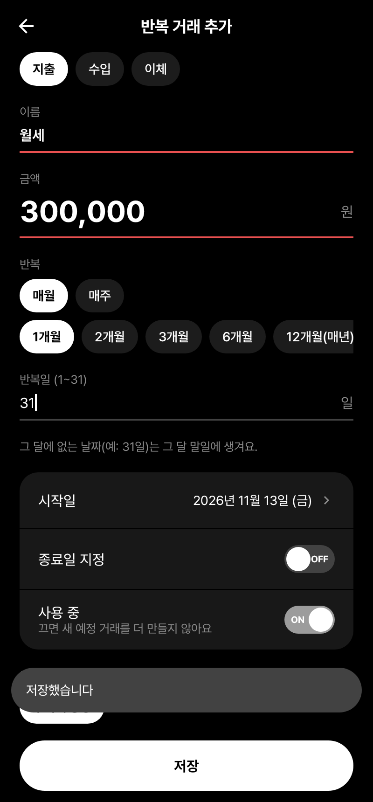
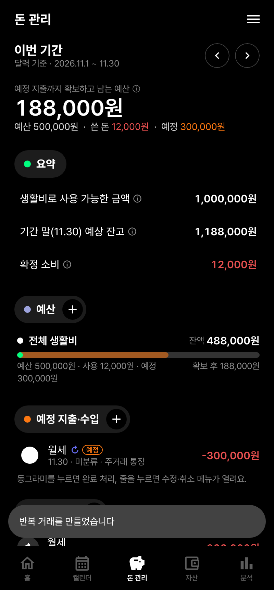

# 루인 가계부 (Looin Finance) — Phase 1

현재 잔고, 예정 지출, 월간 예산, 실제로 쓸 수 있는 여유 금액을 함께 관리하는 Android 가계부 앱입니다.
설계 결정과 계산 규칙, 확인이 필요한 항목은 [docs/PHASE1_PLAN.md](docs/PHASE1_PLAN.md)에 있고,
반복 거래·백업/복원(Phase 2-1)은 [docs/PHASE2_NOTES.md](docs/PHASE2_NOTES.md)에 있습니다.
**출시 준비(Google Play·App Store·PC)는 [docs/release/README.md](docs/release/README.md)** 에서 시작하세요.

디자인은 투두메이트 프로젝트(`claude/replica-skill-install-ll9jb4` 브랜치)의 디자인 시스템을 모티브로 합니다.
검정 배경, 알약 섹션, 날짜 위 동전 마커, 바텀 시트 메뉴, Pretendard 글꼴을 쓰고, 라이트·다크 모드를 모두 지원합니다.

| 홈 | 캘린더 | 돈 관리 |
|---|---|---|
|  |  |  |
| **자산** | **분석** | **거래 입력 (라이트)** |
|  |  |  |
| **반복 거래 추가** | **돈 관리 + 반복 거래** | |
|  |  | |

## 구조

```
core/   재정 계산 Kotlin Multiplatform 모듈 (commonMain: Android·PC(JVM)·iOS 공용)
shared/ 데이터 계층 KMP 모듈: Room 엔티티·DAO, FinanceRepository, 백업(JSON) — Android·PC·iOS 공용
  model/       계좌·거래·카테고리·예산·설정 모델
  period/      달력/월급일 이중 회계 기간 (시작 포함·종료 미포함 구간)
  calc/        잔고·순자산·예상 잔고·예산·사용 가능 금액·통계 계산 + 계산 근거(Breakdown)
  validation/  거래 검증(오류/경고), 계좌 보관·잔고 조정 규칙
app/    Android 앱 (Jetpack Compose)
  ui/          홈·캘린더·돈 관리·자산·분석·거래 입력·설정 화면
```

화면 코드는 원본 데이터만 받고, 모든 금액은 `core`의 계산기로 계산합니다.

## 실행 및 빌드

필요: JDK 17 이상, Android SDK(platform 35, build-tools 35.0.0). `local.properties`에 `sdk.dir=...` 지정.

```bash
./gradlew test                    # 전체 테스트 (core 단위 테스트 + 앱 Robolectric 테스트)
./gradlew :core:jvmTest           # 재정 계산 단위 테스트만 (core 의 test 는 이 작업의 별칭)
./gradlew :app:assembleDebug      # 디버그 APK → app/build/outputs/apk/debug/app-debug.apk
./gradlew :app:installDebug       # 연결된 기기/에뮬레이터에 설치
./gradlew :app:bundleRelease      # 스토어 업로드용 AAB (서명 설정: docs/release/ANDROID_RELEASE.md)
```

Android Studio에서는 저장소 루트를 열고 `app` 구성을 실행하면 됩니다.
UI 흐름 테스트(`AppFlowTest`·`AppFlowDarkTest`)는 실행할 때 라이트·다크 화면 캡처를 `app/build/screenshots/`에 저장합니다.
글꼴 라이선스는 [docs/licenses/FONTS.md](docs/licenses/FONTS.md)에 있습니다.
